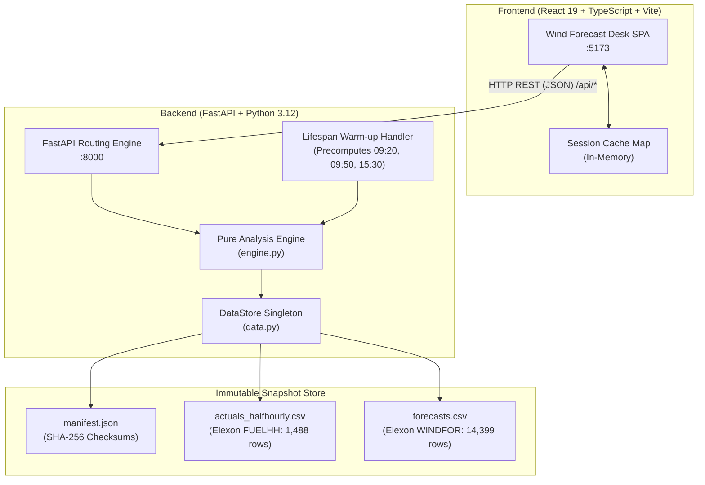

# Wind Forecast Desk

> **UK Wind-Generation Forecast Evaluation and Day-Ahead Purchasing Decision-Support Application**  
> *Gridbricks / REint AI — Full Stack Software Engineer Intern Project*

[](https://www.python.org/)
[](https://fastapi.tiangolo.com/)
[](https://react.dev/)
[](https://www.typescriptlang.org/)
[](https://tailwindcss.com/)
[]()
[](https://github.com/astral-sh/ruff)

---

## 1. Problem Statement

Electricity buyers at UK utilities purchase wholesale electricity through day-ahead auction gates (e.g. EPEX Spot Day-Ahead at 09:20 London time, N2EX Day-Ahead at 09:50 London time, and EPEX Half-Hourly at 15:30 London time). Wind generation is weather-dependent and subject to structural forecast errors:

1. **Strict Decision-Time Cutoffs**: Wholesale commitments must be based solely on wind forecast runs published *strictly before* the auction gate closure. Evaluating decisions using later forecasts or retrospective snapshots introduces severe **look-ahead leakage**.
2. **Empirical Uncertainty**: Point forecasts do not communicate volume risk. Buyers need empirical, leave-one-day-out uncertainty bands (**P10 firm floor**, **P50 expected**, **P90 upside**) to gauge how much volume they can safely contract.
3. **Systematic Bias**: National forecasts systematically over-forecast metered outturn (consistent with transmission curtailment and unmetered embedded generation). Buyers must quantify how error varies by hour of day and by generation level.
4. **Gate Delay Valuation**: Trading desks must assess whether waiting for later auction gates improves forecast accuracy enough to justify intraday price exposure.

**Wind Forecast Desk** reconstructs the exact Elexon BMRS wind forecast run available at any chosen decision cutoff, quantifies empirical uncertainty, and evaluates predictive accuracy against actual metered generation across all 31 delivery days of January 2026.

---

## 2. Live Deployment

| Service | URL |
|---|---|
| **Frontend** | [https://ftlm-five.vercel.app/](https://ftlm-five.vercel.app/) |
| **Backend API** | [https://wind-forecast-api-g0cj.onrender.com/](https://wind-forecast-api-g0cj.onrender.com/) |

---

## 3. Key Features

- **Decision Brief**:
  - Reconstructs the latest forecast run strictly published before the auction cutoff (`publishTime < cutoff` in UTC).
  - Calculates empirical ratio uncertainty bands (**P10 firm volume**, **P50 expected volume**, **P90 upside**) calibrated on the other 30 days via leave-one-day-out methodology.
  - Interactive **Outcome Reveal Mode** toggles actual delivery outturn, quantifying containment rate and volume deviation.
- **Intraday Forecast Drift**:
  - Visualizes forecast revision evolution across successive Elexon model runs (`02:30`, `04:30`, `07:30`, etc.) leading into the gate.
- **Accuracy Lab**:
  - Full statistical evaluation: Mean Absolute Error (MAE: 2,039 MW), Root Mean Square Error (RMSE: 2,514 MW), Mean Bias (-632 MW / -8.7%), and MSE bias proportion (49%).
  - **Diurnal Error Profile**: Hourly bias bars and MAE line across all 24 delivery hours.
  - **Generation Quintiles**: Evaluates forecast accuracy across 5 wind output tiers.
  - **Gate Closure Benchmark**: Compares accuracy across 09:20 EPEX, 09:50 N2EX, and 15:30 Half-Hourly cutoffs.
- **The Look-Ahead Trap**:
  - Direct empirical comparison proving that naive post-hoc matching leaks future model runs and falsely inflates accuracy by **17.27%** (1,687 MW naive MAE vs 2,039 MW realistic decision-time MAE).
- **Data Governance & Integrity**:
  - Offline snapshot verified by cryptographic SHA-256 hashes against `manifest.json`.
  - Zero external network dependencies during standard application execution.

---

## 4. Technology Stack

### Frontend (`frontend/`)
- **Framework**: [React 19.1.0](https://react.dev/) + [TypeScript 5.8.2](https://www.typescriptlang.org/)
- **Build Tool**: [Vite 6.2.0](https://vite.dev/) with [`@tailwindcss/vite` 4.1.2](https://tailwindcss.com/)
- **Visual Styling**: Tailwind CSS v4 design tokens (`frontend/src/styles/tokens.css` using `@theme`)
- **Data Visualization**: [Apache ECharts 5.6.0](https://echarts.apache.org/) via reactive wrapper component
- **Iconography**: [`@phosphor-icons/react` 2.1.10](https://phosphoricons.com/)
- **Typography**: `@fontsource-variable/inter`, `@fontsource/jetbrains-mono`, `@fontsource/instrument-serif`
- **State Architecture**: Pure React `useState` / `useEffect` with an in-memory session cache `Map`. Zero external state-management dependencies (no Redux, Zustand, React Router, or UI kits).

### Backend (`backend/`)
- **Runtime & Framework**: [Python 3.12.3](https://www.python.org/) + [FastAPI 0.115.0](https://fastapi.tiangolo.com/)
- **Server Gateway**: [Uvicorn 0.34.0](https://www.uvicorn.org/) ASGI server
- **Data Processing**: [NumPy 2.2.3](https://numpy.org/) and [Pandas 2.2.3](https://pandas.pydata.org/)
- **Data Integrity**: Cryptographic SHA-256 verification against frozen Elexon snapshot
- **Testing & Quality**: [Pytest 9.2.0](https://docs.pytest.org/) (28 passing tests), [Ruff 0.9.9](https://github.com/astral-sh/ruff) (linter and formatter)

---

## 5. System Architecture



---

## 6. Project Structure

```text
X:\reint\
├── backend/                        # Python backend package
│   ├── app/                        # FastAPI application source
│   │   ├── __init__.py
│   │   ├── config.py               # Constants, timezone, presets, snapshot paths
│   │   ├── data.py                 # DataStore singleton & SHA-256 verification
│   │   ├── engine.py               # Pure mathematical analysis & backtesting logic
│   │   ├── main.py                 # FastAPI endpoints, CORS, lifespan handler
│   │   └── schemas.py              # Pydantic v2 response schemas
│   ├── scripts/                    # Offline ingestion & exploration utilities
│   │   ├── diagnostics.py          # Data diagnostics & distribution analyzer
│   │   ├── explore_elexon.py       # Elexon API streaming endpoint explorer
│   │   └── ingest.py               # Raw BMRS data fetcher & snapshot generator
│   ├── tests/                      # Automated pytest suite & fixtures
│   │   ├── fixtures/               # Reference JSON fixtures for regression testing
│   │   ├── test_api.py             # API route, validation, and CORS tests
│   │   ├── test_engine.py          # Analytical logic & mathematical property tests
│   │   ├── test_regression_fixtures.py # 1e-9 tolerance regression tests
│   │   └── test_snapshot.py        # Snapshot row-count & SHA-256 integrity tests
│   └── README.md                   # Backend architecture and setup notes
│
├── frontend/                       # React frontend single-page application
│   ├── public/                     # Static assets (favicon.svg)
│   ├── src/                        # React TypeScript source code
│   │   ├── api/                    # API client, session cache, and typed responses
│   │   ├── components/             # Reusable UI components & layouts (Header, Footer)
│   │   │   └── ui/                 # Atomic UI (Button, Card, Chart, DayPicker, StatTile)
│   │   ├── hooks/                  # Custom hooks (useApi)
│   │   ├── lib/                    # ECharts themes & number formatting utilities
│   │   ├── pages/                  # Main page views (BriefPage, AccuracyPage, MethodPage)
│   │   ├── styles/                 # Tailwind CSS v4 design tokens (tokens.css)
│   │   ├── App.tsx                 # Root application state & tab coordinator
│   │   └── main.tsx                # React DOM entry point
│   ├── index.html                  # HTML5 template
│   ├── package.json                # Frontend package dependencies & scripts
│   ├── package-lock.json           # Locked npm dependency tree
│   ├── tsconfig.json               # TypeScript compiler configuration
│   └── vite.config.ts              # Vite + Tailwind CSS build configuration
│
├── data/                           # Frozen dataset snapshot & sample payloads
│   ├── samples/                    # Raw Elexon JSON payload samples
│   └── snapshot/                   # Committed January 2026 dataset
│       ├── actuals_halfhourly.csv  # Metered national wind generation (1,488 rows)
│       ├── forecasts.csv           # Valid forecast runs with lead_hours > 0 (14,399 rows)
│       └── manifest.json           # Ingestion metadata & SHA-256 checksums
│
├── docs/                           # Supplementary engineering documentation
│   ├── api_findings.md             # Elexon BMRS endpoint exploration report
│   └── data_diagnostics.md         # Diagnostic data coverage & anomaly report
│
├── project-evidence/               # Audit documentation & verified evidence
│   ├── screenshots/                # 18 high-resolution application screenshots
│   │   └── SCREENSHOT_MANIFEST.md  # Detailed screenshot catalog and capture notes
│   ├── PROJECT_SUMMARY.json        # Machine-readable project metadata
│   └── TECHNICAL_HANDOFF.md        # Comprehensive 17-section engineering audit
│
├── .dockerignore                   # Container build exclusion rules
├── .env.example                    # Sample frontend environment variable
├── .gitignore                      # Comprehensive Git exclusion rules
├── .python-version                 # Python runtime version pin (3.12)
├── pyproject.toml                  # Python dependencies & pytest/ruff configuration
└── README.md                       # This primary documentation file
```

---

## 7. Local Development Setup

### Prerequisites
- **Python**: Version 3.12+ installed
- **Node.js**: Version 20+ and `npm` installed
- **Virtual Environment**: `.venv` in repository root

### Step 1: Backend Setup & Launch

#### Windows PowerShell
```powershell
# Navigate to repository root
Set-Location "X:\reint"

# Activate the virtual environment
.\.venv\Scripts\Activate.ps1

# (Optional) Install dependencies if starting fresh
# pip install -e ".[dev]"

# Launch the FastAPI Uvicorn server on http://127.0.0.1:8000
.\.venv\Scripts\uvicorn.exe backend.app.main:app --host 127.0.0.1 --port 8000 --reload
```

#### Linux / macOS Bash
```bash
# Navigate to repository root
cd /path/to/reint

# Activate the virtual environment
source .venv/bin/activate

# Launch the FastAPI Uvicorn server on http://127.0.0.1:8000
uvicorn backend.app.main:app --host 127.0.0.1 --port 8000 --reload
```

*The backend pre-warms preset evaluation tables (`09:20`, `09:50`, `15:30`) on startup in ~270 ms.*

---

### Step 2: Frontend Setup & Launch

#### Windows PowerShell
```powershell
# Navigate into the frontend directory
Set-Location "X:\reint\frontend"

# (Optional) Install npm packages if starting fresh
# npm install

# Start Vite dev server on http://127.0.0.1:5173
npm run dev
```

#### Linux / macOS Bash
```bash
# Navigate into the frontend directory
cd frontend

# Start Vite dev server on http://127.0.0.1:5173
npm run dev
```

The web application is now available at **http://127.0.0.1:5173**.

---

## 8. API Reference

All backend endpoints return `application/json` with CORS enabled. Interactive Swagger documentation is available at **http://127.0.0.1:8000/docs**.

| Method | Endpoint | Query Parameters | Description |
|---|---|---|---|
| `GET` | `/api/health` | None | Service health check, uptime status, and snapshot SHA-256 integrity confirmation. |
| `GET` | `/api/meta` | None | Metadata listing valid delivery date range, preset cutoffs, provenance URLs, and dataset hashes. |
| `GET` | `/api/brief` | `date` (YYYY-MM-DD)<br/>`cutoff` (HH:MM) | 24-hour delivery schedule, decision-time forecast run, P10/P50/P90 uncertainty bands, and outcome statistics. |
| `GET` | `/api/drift` | `date` (YYYY-MM-DD)<br/>`cutoff` (HH:MM) | Timeline of successive forecast runs published prior to cutoff, tracking forecast revision drift. |
| `GET` | `/api/accuracy` | `cutoff` (HH:MM) | Month-wide accuracy metrics: MAE, RMSE, bias, diurnal profile, quintiles, gate benchmarks, and lookahead leakage. |
| `GET` | `/docs` | None | Interactive OpenAPI Swagger UI documentation. |

---

## 9. Data, Methodology & Governance

### 9.1 Data Source & Provenance
Data is sourced exclusively from the official Elexon Balancing Mechanism Reporting Service (BMRS):
- **Actuals (Metered Wind Generation)**: Elexon BMRS `FUELHH` stream filtered to `fuelType = WIND`. Half-hourly resolution averaged to hourly blocks (`(HH1 + HH2) / 2`).
- **Forecasts (National Wind Runs)**: Elexon BMRS `WINDFOR` stream providing national wind forecasts published every 2 to 4 hours.

### 9.2 Strict Decision-Time Reconstruction
To prevent look-ahead leakage, the decision forecast for delivery day $D$ at London clock cutoff $T$ is selected using strict inequality:
$$\text{publishTime}_{\text{UTC}} < \text{cutoff}_{\text{UTC}}(D, T)$$
The forecast with the maximum $\text{publishTime}$ satisfying this rule is selected for each delivery hour. If no run exists, the hour is marked `missing = true`.

### 9.3 Empirical Uncertainty Calibration
Uncertainty bands are calibrated empirically using a **leave-one-day-out** cross-validation methodology:
1. For delivery day $D$, take all valid hourly points across all *other* 30 delivery days in January 2026.
2. Compute the ratio:
   $$R = \frac{\text{Actual MW}}{\text{Forecast MW}}$$
3. Extract the 10th, 50th, and 90th percentiles ($p_{10}, p_{50}, p_{90}$).
4. Project uncertainty onto day $D$:
   $$\text{Firm Floor (P10)} = \text{Forecast} \times p_{10}$$
   $$\text{Expected (P50)} = \text{Forecast} \times p_{50}$$
   $$\text{Upside (P90)} = \text{Forecast} \times p_{90}$$

### 9.4 Error Conventions & Definitions
- **Forecast Error**: Defined as $\text{Error} = \text{Actual} - \text{Forecast}$.  
  A negative error indicates that wind output fell short of the forecast (**systematic over-forecasting**).
- **Mean Absolute Error (MAE)**: $\frac{1}{N} \sum |\text{Actual} - \text{Forecast}|$
- **Root Mean Square Error (RMSE)**: $\sqrt{\frac{1}{N} \sum (\text{Actual} - \text{Forecast})^2}$
- **Mean Bias**: $\frac{1}{N} \sum (\text{Actual} - \text{Forecast})$

### 9.5 The Look-Ahead Trap
Retrospective forecast evaluation that matches actuals to the "latest forecast published before the delivery hour" leaks future information that was unavailable at the day-ahead auction gate. In January 2026 at cutoff 09:20, naive evaluation reports an MAE of **1,687 MW**, falsely overstating accuracy by **17.27%** compared to the realistic decision-time MAE of **2,039 MW**.

---

## 10. Automated Testing & Verification

### Running Backend Tests
From the repository root:
```powershell
# Windows PowerShell
.\.venv\Scripts\pytest -v

# Linux / macOS Bash
pytest -v
```

**Test Suite Coverage (28 passing tests in ~3.6s)**:
- `test_api.py`: Route status codes, response schemas, CORS headers, 422 validation.
- `test_engine.py`: Strict inequality cutoff checks, UTC/DST handling, hand-computed metrics, golden benchmarks, and band backtest.
- `test_regression_fixtures.py`: Recursively asserts identical key ordering and float values within $10^{-9}$ tolerance against saved fixtures (`accuracy_0920.json`, `accuracy_0950.json`, `accuracy_1530.json`, `brief_20260107_0920.json`).
- `test_snapshot.py`: Row counts (1,488 actuals, 14,399 forecasts), positive lead hours, and cryptographic SHA-256 checksum verification.

### Code Style & Formatting (Ruff)
```powershell
# Check for linting issues
.\.venv\Scripts\ruff.exe check backend

# Verify formatting compliance
.\.venv\Scripts\ruff.exe format --check backend
```

### Frontend Build & Type Check
```powershell
Set-Location "X:\reint\frontend"
npm run build
```
*Compiles TypeScript with `--noEmit` and bundles production assets via Vite with 0 errors.*

---

## 11. Docker & Deployment Status

- **Containerization**: **Prepared / Pending**. Root `.dockerignore` is configured with comprehensive exclusion rules. A multi-stage `Dockerfile` and `docker-compose.yml` can be added in the subsequent containerization phase.
- **Deployment**: Local execution verified on `127.0.0.1:8000` (FastAPI) and `127.0.0.1:5173` (Vite). Production deployment targets include Vercel/Render, Heroku, or Google Cloud Run.

---

## 12. Limitations & Boundary Conditions

1. **Fixed Benchmark Window**: The application is calibrated on the frozen January 2026 evaluation period (`2026-01-02` to `2026-02-01`, 31 delivery days / 744 hours). Passing dates outside this range returns HTTP 422.
2. **Hindcast Ingestion Filtering**: Raw Elexon WINDFOR feeds contain 4,201 historical rows where `publishTime >= startTime` (lead time $\le$ 0h). The ingestion pipeline permanently filters these out to maintain analytical integrity.
3. **Offline Operation**: To guarantee deterministic evaluation and zero runtime network vulnerability, the application operates against the verified snapshot rather than live Elexon streaming endpoints.

---

## 13. Reproducibility Checklist

To reproduce all results from scratch:
1. Clone the repository and confirm `data/snapshot/manifest.json` matches dataset SHA-256 hashes.
2. Run `pytest -v` from the repository root: expect **28 passed**.
3. Run `ruff check backend` and `ruff format --check backend`: expect **All checks passed**.
4. In `frontend/`, run `npm run build`: expect **✓ built in < 20s**.
5. Start backend and verify `GET /api/health` returns `{"status": "ok"}`.

