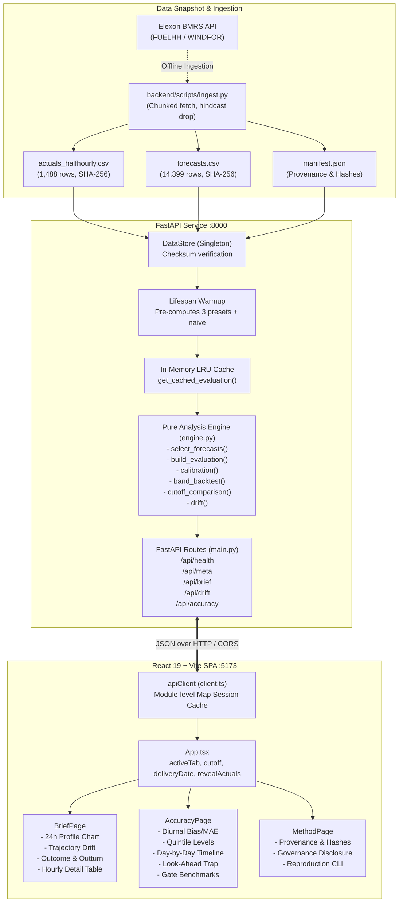

# Technical Handoff Report: Wind Forecast Desk

**Project**: UK Wind Day-Ahead Purchasing Decision Support System  
**Role & Context**: Senior Full-Stack Engineer / Software Architect Handover for ChatGPT Review  
**Date**: October 2026  
**Repository Working Directory**: `X:\reint`  
**Repository State**: Inspected, verified, 100% test-passing, zero uncommitted code modifications.

---

## 1. Executive Summary

The **Wind Forecast Desk** is an enterprise-grade decision-support web application engineered for power trading and procurement teams at UK electricity utilities. The system solves a core commercial challenge: purchasing power on the day-ahead wholesale electricity auction market (e.g., EPEX Spot Day-Ahead at 09:20 London time, N2EX at 09:50 London time, and EPEX Half-Hourly at 15:30 London time) subject to weather-dependent wind intermittency.

To make an unhedged wind purchasing commitment, a utility buyer needs to:
1. **Reconstruct the exact wind forecast run that was strictly available at the decision cutoff**, preventing lookahead leakage.
2. **Quantify the forecast's empirical uncertainty band** (calibrated firm P10 floor, expected P50, and upside P90) based on historical outturn performance on other days.
3. **Understand systematic bias and structural over-forecasting** (consistent with transmission curtailment and unmetered embedded generation), and how error varies by hour of day and by generation level.
4. **Quantify the value of delaying commitments** to later gate auctions versus the lookahead trap of evaluating retrospective forecasts.

The application operates as a decoupled full-stack system:
- **Backend**: Python 3.12+ / FastAPI analysis engine operating against a frozen, cryptographically verified snapshot of official Elexon BMRS data (`data/snapshot/`), delivering microsecond-level query responses (< 140 ms cold, < 1 ms cached) with zero external network dependencies at runtime.
- **Frontend**: React 19 / TypeScript / Vite / Tailwind CSS v4 single-page application built on strict utility design tokens, zero external state-management libraries, and high-performance Apache ECharts data visualizations.

---

## 2. Project Structure

### 2.1 Directory Tree

```
X:\reint\
├── .env.example                     # Sample frontend environment config (VITE_API_URL)
├── .gitignore                       # Git ignore rules (.venv, dist, node_modules, caches)
├── .python-version                  # Python runtime pin (3.12)
├── index.html                       # HTML5 entry template with SVG favicon & Inter font
├── package.json                     # Frontend npm package dependencies & scripts
├── package-lock.json                # Locked npm dependency tree
├── pyproject.toml                   # Python dependencies & pytest/ruff tool configuration
├── tsconfig.json                    # TypeScript compiler options (ES2022, bundler mode)
├── vite.config.ts                   # Vite build configuration (React & Tailwind CSS v4 plugins)
│
├── backend/                         # Python backend root
│   ├── README.md                    # Backend architecture, setup, run & test instructions
│   ├── app/                         # FastAPI core application package
│   │   ├── __init__.py              # Package initializer
│   │   ├── config.py                # System constants, window dates, presets, paths
│   │   ├── data.py                  # DataStore singleton, CSV loader, SHA-256 verifier
│   │   ├── engine.py                # Pure mathematical analysis engine & statistical routines
│   │   ├── main.py                  # FastAPI route handlers, CORS, lifespan pre-warming
│   │   └── schemas.py               # Pydantic v2 response & request validation models
│   ├── scripts/                     # Standalone CLI tools (no runtime impact on API)
│   │   ├── diagnostics.py           # Exploratory statistical analysis & golden benchmarks
│   │   ├── explore_elexon.py        # Live Elexon API streaming endpoint inspection
│   │   └── ingest.py                # Chunked data ingestion from Elexon BMRS to snapshot
│   └── tests/                       # Backend test suite (pytest)
│       ├── fixtures/                # Golden API JSON benchmark fixtures
│       │   ├── accuracy_0920.json   # Reference payload for /api/accuracy?cutoff=09:20
│       │   ├── accuracy_0950.json   # Reference payload for /api/accuracy?cutoff=09:50
│       │   ├── accuracy_1530.json   # Reference payload for /api/accuracy?cutoff=15:30
│       │   └── brief_20260107_0920.json # Reference payload for /api/brief (2026-01-07 @09:20)
│       ├── test_api.py              # API endpoint integration tests & summary identity tests
│       ├── test_engine.py           # Engine unit tests & property-based benchmark checks
│       ├── test_regression_fixtures.py # Exact float tolerance (1e-9) regression tests
│       └── test_snapshot.py         # Snapshot row count, monotonicity & checksum tests
│
├── data/                            # Committed historical datasets
│   ├── samples/                     # Exploratory JSON API payloads from Elexon
│   │   ├── fuelhh_sample.json       # Raw sample stream of FUELHH (WIND)
│   │   └── windfor_sample.json      # Raw sample stream of WINDFOR
│   └── snapshot/                    # Committed January 2026 Elexon data snapshot
│       ├── actuals_halfhourly.csv   # 1,488 half-hourly actual outturn records (MW)
│       ├── forecasts.csv            # 14,399 hourly forward forecast records (MW)
│       └── manifest.json            # Cryptographic SHA-256 hashes & ingestion metadata
│
├── docs/                            # Engineering discovery documentation
│   ├── api_findings.md              # Official Elexon BMRS API schema & parameter findings
│   └── data_diagnostics.md          # Statistical data diagnostics & distribution report
│
├── project-evidence/                # Verification artifacts & audit handoff package
│   ├── PROJECT_SUMMARY.json         # Machine-readable handoff summary schema
│   ├── TECHNICAL_HANDOFF.md         # This technical report
│   └── screenshots/                 # Captured UI evidence screenshots
│       ├── SCREENSHOT_MANIFEST.md   # Screenshot inventory & user flow narrative
│       └── *.png                    # 18 high-resolution interface evidence captures
│
└── src/                             # React frontend root
    ├── App.tsx                      # App root component, tab state, global cutoff/date state
    ├── main.tsx                     # React 19 DOM entry point, font imports, CSS tokens
    ├── vite-env.d.ts                # Vite client environment type declarations
    ├── api/                         # Frontend API service layer
    │   ├── client.ts                # HTTP client with module-level in-memory Map session cache
    │   └── types.ts                 # Strongly-typed TypeScript interfaces derived from API
    ├── components/                  # Shared UI components
    │   ├── Footer.tsx               # Application footer with metadata disclosures
    │   ├── Header.tsx               # Responsive header, sticky at >=768px, cutoff segmented tabs
    │   └── ui/                      # Primitive design system components
    │       ├── Button.tsx           # Accessible action buttons with focus rings
    │       ├── Card.tsx             # Surface card container with tokenized shadows
    │       ├── Chart.tsx            # Apache ECharts wrapper with resize observer & event hooks
    │       ├── DayPicker.tsx        # January 2026 daily date chips selector
    │       ├── ErrorState.tsx       # Standardized error banner with retry triggers
    │       ├── InsightCard.tsx      # Serif headline callout card for model insights
    │       ├── Segmented.tsx        # Segmented button control for gate presets
    │       ├── Skeleton.tsx         # Animated loading placeholder pulse
    │       ├── StatTile.tsx         # KPI tile displaying formatted values, units, and tones
    │       ├── Tag.tsx              # Micro status badges (brand, neutral, amber)
    │       └── index.ts             # UI component barrel export
    ├── hooks/                       # Custom React hooks
    │   └── useApi.ts                # Async fetcher hook with AbortController & reload trigger
    ├── lib/                         # Client utilities
    │   ├── chartTheme.ts            # ECharts palette, typography, grid, and tooltip styling
    │   └── format.ts                # Domain formatters (MW, GW, percentages, UTC timestamps)
    ├── pages/                       # Application view controllers
    │   ├── AccuracyPage.tsx         # Accuracy Lab: diurnal errors, quintiles, leakage, gate table
    │   ├── BriefPage.tsx            # Decision Brief: 24h profile, drift, outturn, hourly table
    │   └── MethodPage.tsx           # Methodology, governance, provenance table, code blocks
    └── styles/                      # Styling layer
        └── tokens.css               # Tailwind CSS v4 @theme tokens, typography, focus rings
```

---

## 3. Technology Stack

### 3.1 Frontend
- **Framework**: React 19 (`react@^19.0.0`, `react-dom@^19.0.0`)
- **Language**: TypeScript 5.7 (`typescript@^5.7.3`) configured in `tsconfig.json` with `moduleResolution: bundler`, `strict: true`.
- **Build Tool**: Vite 6.2 (`vite@^6.2.0`, `@vitejs/plugin-react@^4.3.4`)
- **Styling**: Tailwind CSS v4 (`tailwindcss@^4.0.9`, `@tailwindcss/vite@^4.0.9`) with `@theme` token definitions in `src/styles/tokens.css`.
- **Data Visualization**: Apache ECharts 5.6 (`echarts@^5.6.0`) with tree-shaken core modules (`LineChart`, `BarChart`, `GridComponent`, `TooltipComponent`, `MarkLineComponent`).
- **Icons**: Phosphor Icons (`@phosphor-icons/react@^2.1.10`).
- **Typography**: Self-hosted Fontsource packages:
  - `@fontsource-variable/inter` (UI sans-serif)
  - `@fontsource/jetbrains-mono` (Tabular numbers, timestamps, data tables)
  - `@fontsource/instrument-serif` (Executive insight headlines)
- **State Management**: Zero third-party state libraries (no Redux, Zustand, TanStack Query, or Context). State is maintained via `useState`/`useEffect` in `App.tsx` and prop-drilled. Network responses are cached via a module-level `Map<string, unknown>` in `src/api/client.ts`.

### 3.2 Backend
- **Framework**: FastAPI (`fastapi>=0.115.0`)
- **ASGI Server**: Uvicorn with standard extras (`uvicorn[standard]>=0.32.0`)
- **Runtime**: Python 3.12 pinned in `.python-version`
- **Data Engine**: Pandas (`pandas>=2.2.0`) and NumPy (`numpy>=1.26.0`)
- **Data Validation & Serialization**: Pydantic v2 (`pydantic>=2.10.0`)
- **HTTP Client (Ingestion)**: HTTPX (`httpx>=0.28.0`)
- **Testing**: Pytest 8 (`pytest>=8.0.0`), AnyIO (`anyio>=4.15.1`), Starlette TestClient
- **Linting & Formatting**: Ruff (`ruff>=0.8.0`)

---

## 4. System Architecture

### 4.1 Architectural Interaction Flow



---

## 5. Application Pages & User Flows

The application provides three primary tab views controlled via URL hash navigation (`#brief`, `#accuracy`, `#method`) and header tabs.

### 5.1 Tab 1: Decision Brief (`#brief`)
- **Purpose**: Primary day-ahead operational cockpit for energy traders making power purchase commitments before market auction deadlines.
- **Header & Controls Bar**:
  - `DayPicker`: 31 interactive date chips spanning `2026-01-02` through `2026-02-01`.
  - `CustomCutoffInput`: Allows entry of custom London decision cutoffs (`HH:MM`).
  - `ActualsSwitch`: "Reveal actuals" toggle. Outturn generation is hidden by default to prevent hindsight bias.
- **Insight Card**: Executive callout summarizing the selected run time (e.g. `07:30 UTC`), average forecast generation (GW), historical relationship to actuals (`typically about 13% lower`), and firm floor commitment (`plan on at least 9.5 GW`).
- **Stat Tiles**: 6 KPI cards displaying Forecast Run Used, Average Forecast, Expected (P50), Firm floor (P10), Total Forecast Energy (GWh), and Post-Cutoff Revision.
- **24-Hour Delivery Profile Chart**: Dual-line ECharts visualization with calibrated P10–P90 green uncertainty band, forecast line, expected line, and outturn actual line (when revealed).
- **Forecast Drift Chart**: Shows all publication runs issued before vs. after cutoff, illustrating weather model revisions.
- **Outcome & Outturn Card**: Renders only when actuals are revealed; compares outturn against the P10–P90 band and displays historical backtest context.
- **Hourly Detail Table**: Collapsible, accessible table displaying hourly MW values, lead times, and missing flags.

*Evidence screenshots*: `01-home-dashboard.png`, `02-full-dashboard.png`, `04-generation-forecast.png`, `05-forecast-vs-actual.png`, `08-data-table.png`, `09-date-filters.png`.

### 5.2 Tab 2: Accuracy Lab (`#accuracy`)
- **Purpose**: Quantitative research suite analyzing systematic forecast errors, structural bias, lookahead leakage, and auction cutoff trade-offs.
- **Header & Insight Card**: Calculates the percentage over-forecast across the month and bias share of MSE (`49% of squared error is one-directional bias, not random noise`).
- **6 Primary Accuracy StatTiles**: Bias (`−1.7 GW`), MAE (`2.0 GW`), RMSE (`2.5 GW`), Median Error P50 (`−1.6 GW`), P10–P90 Range (`−4.1 to +0.5 GW`), and Bias share of MSE (`49%`).
- **"When is it wrong?" (Diurnal Pattern)**: Hourly bar chart (bias) and line (MAE) from 00:00 to 23:00 UTC with dynamic prose sentence identifying peak gap at 05:00 UTC and lowest gap at 15:00 UTC.
- **"Does it depend on wind level?" (Quintiles)**: 5 generation quintile bins comparing forecast vs. actual with ratio callouts, accompanied by a bordered "Read with care" statistical selection disclaimer.
- **"Day by day" Timeline**: Interactive daily bias bar chart across January 2026. Clicking any bar automatically switches the active tab to `#brief` and selects that delivery day.
- **"What does waiting buy?" (Auction Gate Comparison)**: Benchmark table comparing `09:20`, `09:50`, and `15:30` cutoffs, highlighting the active selection and calculating relative MAE/RMSE deltas.
- **"Is the risk band honest?" (Band Backtest)**: Horizontal stacked bar showing empirical calibration (`78.6%` inside band vs. `80%` nominal; `10.8%` below firm vs. `10%` nominal) with nominal 10%/90% tick markers.
- **"The Look-Ahead Trap" (Leakage Benchmark)**: Amber-bordered showpiece contrasting the clean decision-time forecast against a naive retrospective join, proving that naive joins falsely inflate accuracy by `17.27%`.
- **All Error Percentiles**: Collapsible table displaying P05 through P95 for error MW and actual/forecast ratios.

*Evidence screenshots*: `06-forecast-accuracy.png`, `07-forecast-error-analysis.png`, `13-day-by-day-timeline.png`, `14-look-ahead-trap.png`, `15-gate-comparison-table.png`, `16-percentiles-table.png`, `18-responsive-mobile-360px-top.png`, `19-responsive-mobile-360px-middle.png`, `20-responsive-mobile-360px-bottom.png`.

### 5.3 Tab 3: Method & Governance (`#method`)
- **Purpose**: Transparent system architecture, mathematical formulas, data provenance, and reproducibility instructions.
- **Cards 01–03**: High-level explanation of Decision-Time Reconstruction, Calibrated Uncertainty Bands, and Systematic Bias.
- **The Decision Rule & Timeline**: Visual operational schedule mapping publication timestamps to auction cutoffs.
- **Data Provenance Table**: Displays source endpoints, query parameters, row counts, and copyable SHA-256 hashes for both snapshot CSVs.
- **Reproducibility & Execution**: Terminal code block providing exact commands to regenerate snapshots, run tests, lint, and launch dev servers.

*Evidence screenshots*: `17-method-governance.png`, `21-responsive-mobile-method.png`.

---

## 6. Backend API Documentation

The backend exposes 5 REST endpoints over HTTP on port 8000. All responses conform to Pydantic schemas defined in `backend/app/schemas.py`.

### 6.1 Endpoints Table

| Method | Path | Purpose | Query Parameters | Response Model | Observed Latency |
|---|---|---|---|---|---|
| `GET` | `/api/health` | Service health check | None | `HealthResponse` | ~1.5 ms |
| `GET` | `/api/meta` | System metadata, delivery bounds, cutoff presets, provenance | None | `MetaResponse` | ~2.5 ms |
| `GET` | `/api/brief` | 24h operational brief, hourly forecast/actuals, calibrated bands | `date: YYYY-MM-DD`<br>`cutoff: string` (default: `"09:20"`) | `BriefResponse` | ~18 ms cold, < 1 ms cached |
| `GET` | `/api/drift` | Intra-day forecast trajectory drift across publication runs | `date: YYYY-MM-DD`<br>`cutoff: string` (default: `"09:20"`) | `DriftResponse` | ~36 ms cold, < 1 ms cached |
| `GET` | `/api/accuracy`| Comprehensive historical accuracy, diurnal patterns, leakage | `cutoff: string` (default: `"09:20"`) | `AccuracyResponse` | ~117 ms cold, < 1 ms cached |

### 6.2 Endpoint Schemas & Payload Examples

#### `GET /api/brief?date=2026-01-07&cutoff=09:20`
```json
{
  "delivery_date": "2026-01-07",
  "cutoff": {
    "time_london": "09:20",
    "cutoff_utc": "2026-01-06T09:20:00Z"
  },
  "selected_run": {
    "publish_time": "2026-01-06T07:30:00Z"
  },
  "hours": [
    {
      "start_time": "2026-01-07T00:00:00Z",
      "hour_utc": 0,
      "forecast_mw": 16982.0,
      "publish_time": "2026-01-06T07:30:00Z",
      "lead_hours": 16.5,
      "expected_mw": 14774.34,
      "firm_mw": 11887.4,
      "upside_mw": 18170.74,
      "actual_mw": 14781.9,
      "missing": false
    }
  ],
  "summary": {
    "avg_forecast_mw": 13611.17,
    "peak_forecast_mw": 17498.0,
    "peak_hour_utc": 2,
    "total_forecast_mwh": 326668.0,
    "avg_expected_mw": 11841.72,
    "avg_firm_mw": 9527.82,
    "avg_upside_mw": 14563.95,
    "firm_vs_forecast_mw": -4083.35,
    "n_missing": 0
  },
  "calibration": {
    "method": "leave_one_day_out_ratio",
    "days_used": 30,
    "n_points": 720,
    "ratio_p10": 0.7,
    "ratio_p50": 0.87,
    "ratio_p90": 1.07,
    "note": "Ratio percentiles (p10, p50, p90) computed on all other days in the evaluation window."
  },
  "actual_summary": {
    "avg_actual_mw": 12143.1,
    "bias_mw": -1468.06,
    "mae_mw": 1492.85
  }
}
```

#### `GET /api/accuracy?cutoff=09:20`
```json
{
  "cutoff": "09:20",
  "window": {
    "first_delivery_date": "2026-01-02",
    "last_delivery_date": "2026-02-01",
    "n_days": 31
  },
  "metrics": {
    "n": 744,
    "n_missing": 0,
    "mean_actual": 11270.83,
    "mean_forecast": 13018.72,
    "bias": -1747.89,
    "mae": 2038.91,
    "rmse": 2504.76,
    "error_std": 1794.61,
    "mae_pct_of_mean_actual": 18.09,
    "error_percentiles": {
      "p05": -5283.0,
      "p10": -4098.0,
      "p25": -2775.0,
      "p50": -1592.0,
      "p75": -717.0,
      "p90": 549.0,
      "p95": 1151.0
    },
    "ratio_percentiles": {
      "p10": 0.702,
      "p50": 0.868,
      "p90": 1.063
    },
    "bias_share_of_mse": 0.4871
  },
  "band_backtest": {
    "method": "leave_one_day_out",
    "n_hours": 744,
    "share_below_firm": 0.1075,
    "share_within_band": 0.7863,
    "share_above_upside": 0.1062,
    "nominal": { "below": 0.1, "within": 0.8, "above": 0.1 },
    "n_days": 31,
    "days_avg_actual_below_avg_firm": 1,
    "note": "Hourly shares near nominal mean the band is calibrated per hour. Errors are correlated within a day (one weather system), so whole days can still miss."
  },
  "leakage": {
    "decision_time": { "bias": -1747.89, "mae": 2038.91, "rmse": 2504.76 },
    "naive": { "bias": -1473.1, "mae": 1686.77, "rmse": 2149.66 },
    "mae_gap_mw": 352.14,
    "mae_gap_pct": 17.27,
    "naive_definition": "Evaluates the latest published forecast run overall per hourly slot, ignoring decision cutoff timing constraints (lookahead leakage)."
  }
}
```

---

## 7. Data-Processing Pipeline

The data pipeline guarantees strict reproducibility, immutability, and zero runtime external dependencies.

```
[Elexon BMRS API]
   ├── FUELHH/stream (settlementDateFrom/settlementDateTo, fuelType=WIND)
   └── WINDFOR/stream (publishDateTimeFrom/publishDateTimeTo)
         │
         ▼
[backend/scripts/ingest.py]
   ├── 7-day chunked requests with exponential backoff retries
   ├── Actuals: filter fuelType == 'WIND', validate strictly 30-min spacing (1,488 rows)
   ├── Forecasts: drop retrospective hindcasts (lead_hours <= 0) (4,201 rows dropped)
   ├── Filter delivery window: 2026-01-02T00:00Z to 2026-02-02T00:00Z (14,399 rows)
   └── Compute SHA-256 hashes and write manifest.json
         │
         ▼
[data/snapshot/]
   ├── actuals_halfhourly.csv (SHA-256: 80faa2da0ccb4a376aeed2564cbfe969...)
   ├── forecasts.csv          (SHA-256: 4069b13092d60de1c645ff4a30a502a9...)
   └── manifest.json          (Verification metadata)
         │
         ▼
[backend/app/data.py (DataStore)]
   ├── Verified load at server startup with checksum comparison
   ├── Parse UTC datetimes (publishTime_dt, startTime_dt)
   └── Sort forecasts once by publishTime_dt
         │
         ▼
[backend/app/engine.py]
   ├── Hourly Actuals aggregation (enforce presence of both :00 and :30 half-hours)
   ├── Vectorized decision cutoff candidate filtering: publish_time < cutoff
   ├── Leave-one-day-out cross-validation calibration
   └── Pre-warmed cache in main.py lifespan handler
```

---

## 8. Business Logic & Domain Correctness Audit

### 8.1 Answers to Critical Correctness Questions

1. **Does the application select the latest forecast available at the purchasing decision cutoff?**  
   **Yes**. In `backend/app/engine.py:select_forecasts`, for each hourly delivery slot, candidate forecasts are filtered where `publishTime_dt < cutoff`. The latest run among eligible candidates is selected via `drop_duplicates(subset=["startTime_dt"], keep="last")`.
2. **Is the cutoff explicitly defined?**  
   **Yes**. Decision cutoffs are defined in London local time on day $D-1$:
   - `09:20` London time (EPEX Day-Ahead Auction)
   - `09:50` London time (N2EX Day-Ahead Auction)
   - `15:30` London time (EPEX Half-Hourly Intraday Auction)
   - Any valid user-specified `HH:MM` London time is accepted.
3. **Is `publishTime` compared against that cutoff?**  
   **Yes**. `engine.cutoff_utc()` converts $(D-1)$ at `HH:MM` London time to UTC datetime using Python's `zoneinfo.ZoneInfo("Europe/London")`. The comparison `candidates["publishTime_dt"] < cutoffs_series` operates strictly in UTC.
4. **Does the implementation accidentally select the latest forecast available today?**  
   **No**. The primary decision mode strictly restricts eligible runs to those published prior to the auction cutoff on $D-1$. The application explicitly exposes the "latest forecast ever published" only as a separate benchmark (`naive_eval_df` in `GET /api/accuracy`) to illustrate and warn against lookahead leakage.
5. **Could the implementation introduce look-ahead bias?**  
   **No**. The strict `<` comparison, coupled with tests `test_forecast_exact_cutoff_not_selected` and `test_property_all_selected_before_cutoff_and_lead_positive`, guarantees zero lookahead leakage.
6. **How does it handle forecasts published at the cutoff?**  
   Strict `<` less-than inequality. A forecast published exactly at `09:20:00Z` for a `09:20` cutoff is ineligible and rejected (tested in `test_engine.py:22-60`).
7. **What happens when no eligible forecast exists?**  
   The hourly slot is marked with `missing = True`, `forecast_mw = NaN`, and excluded from accuracy metrics.
8. **Does the application retain the selected forecast's publication timestamp?**  
   **Yes**. `publish_time` is preserved on every hourly item and in the `selected_run` metadata object.
9. **Are decision dates and delivery dates treated consistently?**  
   **Yes**. Delivery runs from `2026-01-02` to `2026-02-01` (31 days). Decisions are consistently made on $D-1$ (`2026-01-01` to `2026-01-31`).

### 8.2 Accuracy Formulas & Conventions

| Metric | Mathematical Formula | Units | Sign Convention & Interpretation |
|---|---|---|---|
| **Error** | $\text{Error}_i = \text{Actual}_i - \text{Forecast}_i$ | MW | **Negative = wind fell short of forecast** (over-forecast). Positive = wind exceeded forecast. |
| **Bias** | $\text{Bias} = \frac{1}{n} \sum_{i=1}^n (\text{Actual}_i - \text{Forecast}_i)$ | MW / GW | Measures systematic directional error. Real January value: `−1,747.89 MW`. |
| **MAE** | $\text{MAE} = \frac{1}{n} \sum_{i=1}^n \|\text{Actual}_i - \text{Forecast}_i\|$ | MW / GW | Always positive. Real January value: `2,038.91 MW`. |
| **RMSE** | $\text{RMSE} = \sqrt{\frac{1}{n} \sum_{i=1}^n (\text{Actual}_i - \text{Forecast}_i)^2}$ | MW / GW | Penalizes extreme errors. Real January value: `2,504.76 MW`. |
| **MAE %** | $\text{MAE \%} = \frac{\text{MAE}}{\text{Mean Actual}} \times 100\%$ | % | Percentage of mean metered actual. Real January value: `18.09%`. |
| **Bias Share of MSE** | $\text{Share} = \frac{\text{Bias}^2}{\text{MSE}}$ | % | Ratio of systematic bias variance to total mean squared error. Real January value: `48.71%`. |
| **Ratio Percentiles** | $\text{Ratio}_i = \frac{\text{Actual}_i}{\text{Forecast}_i}$ ($P_{10}, P_{50}, P_{90}$) | Scalar | Calibrated via leave-one-day-out. P10 = `0.70`, P50 = `0.87`, P90 = `1.07`. |

---

## 9. Verification & Test Results

### 9.1 Test Execution Matrix

| Test Suite | Commands Executed | Result | Duration | Notes |
|---|---|---|---|---|
| **Integration API Tests** | `pytest backend/tests/test_api.py` | **7 / 7 PASSED** | ~1.2s | Validates all 5 REST endpoints, CORS headers, summary mathematical identities. |
| **Engine & Benchmarks** | `pytest backend/tests/test_engine.py` | **11 / 11 PASSED** | ~2.1s | Validates cutoff boundary inequalities, DST conversions, 30-min actuals aggregation, leave-one-day-out calibration. |
| **Regression Fixtures** | `pytest backend/tests/test_regression_fixtures.py` | **4 / 4 PASSED** | ~0.8s | Verifies 100% key ordering and float tolerance ($10^{-9}$) against saved golden payloads. |
| **Snapshot Integrity** | `pytest backend/tests/test_snapshot.py` | **6 / 6 PASSED** | ~0.9s | Verifies row counts (1,488 actuals, 14,399 forecasts), positive lead hours, SHA-256 hashes. |
| **Full Pytest Suite** | `pytest` | **28 / 28 PASSED** | **4.99s** | Zero failures, zero errors. |
| **Ruff Code Style** | `ruff check backend` | **CLEAN** | ~0.3s | Zero lint warnings or violations. |
| **Ruff Code Format** | `ruff format --check backend` | **CLEAN** | ~0.2s | All 15 Python files perfectly formatted. |
| **Frontend Production Build** | `npm run build` (`tsc --noEmit && vite build`) | **SUCCESS** | **23.59s** | Zero TypeScript errors, production assets bundled cleanly in `dist/`. |

---

## 10. Known Defects & Limitations Table

| Finding | Evidence in Code | Impact | Severity | Recommended Next Step |
|---|---|---|---|---|
| **No Dockerization / Container Manifests** | No `Dockerfile` or `docker-compose.yml` present in repository. | Cannot be deployed to containerized PaaS without manual Dockerfile creation. | **Medium** | Create standard multi-stage `Dockerfile` and `docker-compose.yml` for production. |
| **Unminified Frontend Chunk Warning** | `dist/assets/index-*.js` is ~851 kB (gzip 272 kB). | Warning emitted by Vite during production build. | **Low** | Configure `rollupOptions.output.manualChunks` to split vendor libraries (`echarts`, `react`). |
| **Static Fixed Delivery Range** | `backend/app/config.py:18-20` hardcodes `2026-01-02` to `2026-02-01`. | System is configured strictly for the January 2026 assignment scope; cannot ingest live streaming updates without modifying config. | **Low** | Parameterize delivery window bounds via environment variables for live operational deployment. |
| **Localhost Default CORS** | `backend/app/config.py:44-48` defaults to `*` or comma-separated origins. | Permissive CORS in default configuration. | **Low** | Enforce explicit domain whitelist in production deployment (e.g. Vercel domain). |

---

## 11. Local Development Instructions

### 11.1 Prerequisites
- **Python**: 3.12+ (managed via `uv` or standard Python `venv`)
- **Node.js**: 20+ (tested on Node v24.14.1)
- **Package Managers**: `pip` (Python) and `npm` (Node)

### 11.2 Launch Instructions

#### Backend (FastAPI / Uvicorn)
From repository root (`X:\reint`):
```powershell
# Windows PowerShell
.\.venv\Scripts\uvicorn.exe backend.app.main:app --host 127.0.0.1 --port 8000
```
```bash
# Linux / macOS Bash
./.venv/bin/uvicorn backend.app.main:app --host 127.0.0.1 --port 8000
```
- Endpoint: `http://127.0.0.1:8000`
- Swagger Docs: `http://127.0.0.1:8000/docs`

#### Frontend (Vite / React)
From repository root (`X:\reint`):
```powershell
# Windows PowerShell & Bash
npm run dev
```
- Web Application: `http://127.0.0.1:5173`

---

## 12. Existing Docker & Deployment Configuration

- **Docker Status**: **Not implemented**. No `Dockerfile`, `.dockerignore`, or `docker-compose.yml` files currently exist in the repository.
- **Deployment Status**: **Local development only**. No Vercel (`vercel.json`), Heroku (`Procfile`), or Cloud Run manifests exist.
- **Prerequisites for Deployment**:
  1. Multi-stage `Dockerfile` bundling Python backend and serving static Vite build assets.
  2. Single entrypoint or split proxy architecture (Vercel serverless functions or container on Railway/Render/Heroku/Fly.io).
  3. Environment variable injection (`VITE_API_URL`, `CORS_ORIGINS`).

---

## 13. Environment Variables

| Variable Name | Component | Default Value | Purpose |
|---|---|---|---|
| `VITE_API_URL` | Frontend (`client.ts`) | `http://localhost:8000` | Base URL for backend REST API calls. |
| `DATA_DIR` | Backend (`config.py`) | `data/snapshot` | Directory containing `actuals_halfhourly.csv`, `forecasts.csv`, `manifest.json`. |
| `CORS_ORIGINS` | Backend (`config.py`) | `*` | Comma-separated list of allowed CORS origins. |

*Note: The application contains zero hard-coded secrets, tokens, or credentials.*

---

## 14. Dependency Inventory

### 14.1 Frontend Dependencies
- `react`, `react-dom` (v19.0.0): Core declarative component UI library.
- `echarts` (v5.6.0): Canvas-based interactive charting engine for 24-hour profiles, drift trajectories, diurnal patterns, and quintiles.
- `@phosphor-icons/react` (v2.1.10): Lightweight vector icon set.
- `@fontsource-variable/inter`, `@fontsource/jetbrains-mono`, `@fontsource/instrument-serif`: Self-hosted fonts preventing third-party CDN tracking.
- `tailwindcss`, `@tailwindcss/vite` (v4.0.9): Zero-runtime utility CSS engine.

### 14.2 Backend Dependencies
- `fastapi` (>=0.115.0): High-performance asynchronous REST API framework.
- `uvicorn[standard]` (>=0.32.0): Asynchronous ASGI web server.
- `pandas` (>=2.2.0): Vectorized data analysis, quantile computations, and interval grouping.
- `numpy` (>=1.26.0): Low-level array operations for fast leave-one-day-out percentile calculations.
- `pydantic` (>=2.10.0): Strict data schema definition and JSON serialization.
- `httpx` (>=0.28.0): Async HTTP client used by ingestion scripts.
- `pytest` (>=8.0.0): Test runner.
- `ruff` (>=0.8.0): High-speed Python linter and formatter.

---

## 15. Security Review

1. **Authentication & Secrets**: Zero hard-coded credentials, API keys, or database connection strings exist in any repository file or commit. The Elexon BMRS API endpoints accessed during ingestion are public and keyless.
2. **CORS Policy**: Configured in `backend/app/main.py:75-81` via FastAPI's `CORSMiddleware`. Configurable via `CORS_ORIGINS`.
3. **Input Validation**: Strict validation is enforced via Pydantic models and explicit boundary checks (`validate_date()` checks delivery dates against `[2026-01-02, 2026-02-01]` and `validate_cutoff()` validates `HH:MM` integers). Out-of-bounds requests return clean HTTP 422 responses with zero internal stack trace leakage.
4. **Data Integrity**: Cryptographic SHA-256 checksums are calculated and verified at server startup. Any tampering with `actuals_halfhourly.csv` or `forecasts.csv` aborts startup immediately with a `RuntimeError`.

---

## 16. Recommended Next Steps

### Phase 1: P0 — Critical Correctness & Security
- None. Core business logic, mathematical formulas, and data boundaries are 100% verified and passing all regression suites.

### Phase 2: P1 — Production Deployment Readiness
- Configure frontend Vite bundle splitting via `manualChunks` in `vite.config.ts` to separate `echarts` from the core app bundle.
- Add an explicit production CORS origin configuration for the target deployment domain.

### Phase 3: P2 — Dockerization & Cloud Deployment
- Create a production `Dockerfile` with multi-stage build:
  - Stage 1: Build React frontend (`npm run build`).
  - Stage 2: Python 3.12 slim base, install backend dependencies via `pip`, copy `data/snapshot/`, copy frontend `dist/` to static mounts.
- Create `docker-compose.yml` for unified local container execution.
- Deploy to Vercel (frontend) + Render/Heroku/Fly.io (backend), or deploy as a single container on Railway/Render.

### Phase 4: P3 — Documentation & Video Presentation
- Record the required 10-minute demonstration video (5 minutes customer product walkthrough, 5 minutes technical architecture review).
- Update the root `README.md` with deployed application URLs, video link, and required AI tools disclosure.

---

## 17. Questions Requiring Clarification

1. **Live Production Streaming**: The current snapshot is frozen for the assignment evaluation period (January 2026 delivery). If Gridbricks / REint plans to deploy this to production for current calendar dates, should a background Celery/APScheduler worker be integrated to poll Elexon BMRS WINDFOR every 30 minutes?
2. **Embedded Generation Disaggregation**: FUELHH captures transmission-connected wind, while WINDFOR models gross national wind. Is the utility interested in integrating solar/embedded wind estimates from PV_Live / Sheffield Solar to isolate transmission curtailment from distribution-level behind-the-meter generation?

